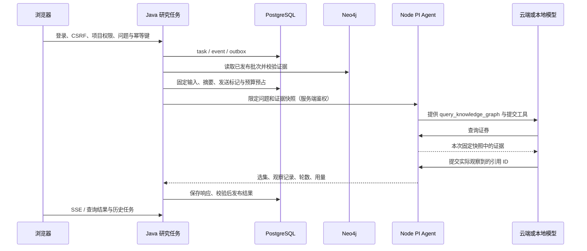

# Java 任务与 PI Agent 知识问答

更新：2026-11-17。工程：`<仓库根目录>`。

## 已完成的业务

进入 `/knowledge-graph`，输入股票代码，在“向投研 Agent 提问”中提交问题。Java 创建持久化研究任务，固定一个已审核发布的公告批次；PI Agent 调用只读查询工具，再提交相关证据 ID。Java 根据原文构建回答并验收，页面显示引文、语气、页段、PDF 与公开来源，支持取消、历史任务与刷新恢复。

模型负责选择相关证据，事实表述直接使用已验收原文。第一版不生成自由发挥的长报告，也不把公告计划写成已发生事实。资料不足返回 `INSUFFICIENT_EVIDENCE`；没有已发布证据时不调用模型。



Java 在执行阶段预取实际 Neo4j 证据；本次 PI 查询工具读取该不可变快照，不再反向借用浏览器 Cookie 请求 Java。模型无法选择项目、执行 Cypher 或访问任意 URL。原 Node 项目 ID 不作为 Java 授权依据。

## 接口与兼容

提交：`POST /api/projects/{project}/knowledge/questions`。网页经既有 `/api/java` 同源代理调用。

```json
{"securityId":"600519","question":"已审核公告有哪些计划事件？请列出原文依据。","releaseId":null}
```

需要 OWNER、CSRF 和 `Idempotency-Key`；相同键相同输入返回已有任务，输入变化返回 409。第一版支持沪深 A 股，问题最多 1000 字，最多 5 条证据；未指定版本时选最新 READY 的已审核发布批次。只读成员可查看所属项目历史任务与结果。

结果、取消、SSE 继续使用 `/research/tasks/{id}` 下的现有接口。新增类型 `KNOWLEDGE_QA`，原确定性风险请求校验不放宽，序列化时不增加空的 question 字段，保留旧请求摘要；知识任务不会保存虚假的行情快照。

Flyway V5 增加 `sf_agent_run`，保存固定输入、输入摘要、原始 Agent 响应、发送状态和预算结算。Java worker 仍使用现有任务租约、截止、接管和结果验收机制，不新增第二套调度器。

## 本机启动

```powershell
# 在仓库根目录执行
# 首次补齐新配置；保留已有账号和令牌
.\scripts\init-dev.ps1
.\scripts\start-infra.ps1
```

首次使用工作台先执行 `./scripts/setup-frontend.ps1`。随后在两个终端运行：

```powershell
.\scripts\start-backend.ps1
```

```powershell
.\scripts\start-frontend.ps1
```

打开 `http://127.0.0.1:58872/knowledge-graph`。两个应用使用既有本地账号映射，Java 会话重启后需要重新连接；任务和结果保存在数据库。采集公告、解析 PDF 和查询图谱由 Spring Boot 执行；PI Agent 由同一项目的 Next.js 服务执行。

服务端配置位于根 `.env`，不能放到 `NEXT_PUBLIC_*`：

| 配置 | 用途 |
| --- | --- |
| `SIGNALFORGE_AGENT_TOKEN` | Java 与 Node 的共享服务令牌，init-dev 补齐，至少 32 字符 |
| `SIGNALFORGE_AGENT_URL` | Node 原点，默认 `http://127.0.0.1:58872`；改变网页端口时同步修改并重启 Java |
| `SIGNALFORGE_AGENT_PROVIDER` | `deepseek` 或 `openai-compatible` |
| `SIGNALFORGE_AGENT_MODEL` | 问答模型，默认 `deepseek-flash` |
| `SIGNALFORGE_DEEPSEEK_API_KEY` | 官方云端密钥；已按用户提供的连接资料配置到本机服务端 |
| `SIGNALFORGE_AGENT_BASE_URL` | 本地兼容模型地址，例如 `http://127.0.0.1:8000/v1` |
| `SIGNALFORGE_AGENT_API_KEY` | 本地模型服务可选认证值 |
| `SIGNALFORGE_MODEL_DAILY_TOKEN_LIMIT` | 同项目问答与正文抽取共享的每日额度 |

切换本地模型时，将 provider 设为 `openai-compatible`，填写实际模型名和回环地址，重启工作台。模型必须支持流式工具调用；本轮验证了适配配置和假模型合同，未启动本地推理服务实测。Java 正文候选抽取仍使用原 DeepSeek 配置，不宣称所有模型入口已经统一。

## 执行与用量边界

- PI 每次运行最多 3 轮、3 次工具调用，图谱查询最多 2 次；输出预算 4096 Token，单轮上限 1536，估算输入预算 16000，运行超时 65 秒。
- Java 在外部调用前保存 SENDING 和 65536 Token 的保守预占，收到完整成功用量后结算；预占是调度预算，并非供应商硬计费上限。
- 不完整/估算用量显式标记，并保留剩余保守额度。调用结果未知不自动重发、不自动退还预占，需人工核对；不能宣称远程推理只执行一次。
- 已保存 RETURNED 响应可在重启后继续验收，不重新付费。崩溃时仅有 SENDING 标记则返回 `AGENT_OUTCOME_UNKNOWN`。
- Java 每 500ms 检查执行权、项目成员和截止时间，失效即取消本地 HTTP；远端中止是尽力而为，可能已经计费。取消/旧执行权/权限撤销均不能发布成功结果。
- 没有跨任务的语义答案缓存；幂等重放和已保存响应复用仅针对同一持久化任务。
- 引用校验保证出处和原文来自工具结果，不保证模型的相关性选择一定正确；覆盖仅为选定公告批次，不是完整公告历史，也不是历史回测证据。

## 验收

2026-11-17 完整 Java 49 项通过；Node Agent、内部接口、图谱工具与代理 25 项通过；完整 TypeScript、定向 ESLint 通过。覆盖鉴权、CSRF、幂等、旧风险合同、预算、取消、权限撤销、伪造引用及响应保存后的重启恢复。

真实问答使用本地已审核的贵州茅台公开公告。检查唯一引文后匿名下载 PDF，其 SHA-256 与本地文档摘要一致，再提交限定公开内容的模型请求。实际 PI 执行 2 轮，输入 2427、输出 162、合计 2589 Token，成功保存一条 PLANNED 引文。此前工具协议短测另使用 421 Token。

本机 Google Chrome 检查登录、Java 会话、历史问答、引用、刷新恢复、移动布局和页面错误，共 7 项通过；浏览器检查不再发起付费请求。

```powershell
.\scripts\check-backend.ps1
Set-Location frontend
node node_modules/vitest/vitest.mjs run src/lib/java/knowledge-agent.test.ts src/lib/domains/finance/agent-tools/knowledge-graph.test.ts src/lib/java/bridge.test.ts src/app/api/internal/knowledge-agent/route.test.ts
Set-Location ..
# 将此值替换为当前项目「最近问答」中已完成且有引用的任务 ID
node verification/node/smoke-knowledge-agent.mjs '00000000-0000-0000-0000-000000000000'
```

原 Agent 写文件工具仍有既有 Windows 回归问题；知识问答不装配写文件工具。

浏览器验收需要本机 Chrome、运行中的工作台和 Java 服务，以及当前开发账号可访问的历史问答。报告与截图写入 `.runtime/agent-browser/`。
