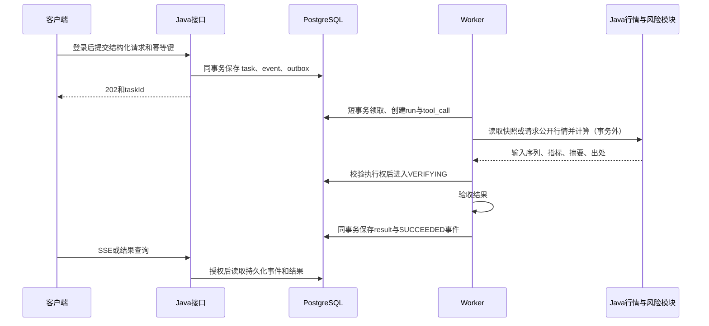

# Java 确定性研究链路

当前代码位于 backend，采用 Java21、Spring Boot4.0.9、Spring MVC、Security、MyBatis Plus3.5.18、JdbcTemplate 和 Flyway。MyBatis mapper 负责项目成员查询；任务竞争与状态转换使用明确 SQL。Spring Data Redis 短期缓存分时行情，PostgreSQL 复用风险分析的日线快照；Neo4j已由knowledge模块用于证券关系的版本投影和实际查询。Spring Boot 同源提供基础研究页，Next.js 提供完整工作台。

## 模块与执行

platform 管登录、项目成员与错误合同；research 管结构化请求、任务状态、事件和 Worker；finance 管 ETF 取数、指标计算和结果验收；infrastructure 管 JSON、摘要和有界 HTTP；knowledge 管证券公告采集、PDFBox 解析、关系证据、独立任务及 Neo4j 投影。当前无需模型即可执行 ETF 风险比较。

## 持久化与一致性

| 表 | 责任 |
| --- | --- |
| sf_user / sf_project / sf_project_member | 开发账号、项目、OWNER或READER成员 |
| sf_task | 请求、项目内幂等键、状态、截止时间、事件序号、租约与执行令牌 |
| sf_task_run | 每次领取的执行记录、worker身份和令牌 |
| sf_tool_call | 风险工具调用的请求摘要、响应及验收状态 |
| sf_task_event | 任务内连续递增事件，用于SSE恢复 |
| sf_outbox | 与创建任务同事务提交的派发记录 |
| sf_task_result | 唯一成功结果、请求摘要、结果摘要与对应run |
| sf_market_snapshot | 通过验收的行情输入、来源、数据版本、精确区间与复用期限 |
| sf_knowledge_job | 独立证券采集任务、幂等、租约、取消和执行权 |
| sf_knowledge_snapshot | 原始响应text、摘要、图谱清单及PENDING/READY来源版本 |
| sf_knowledge_outbox | 与来源暂存同事务的投影待办及完成记录 |
| sf_document_version / sf_document_catalog | 原始PDF、摘要、解析页段和跨采集版本关联 |
| sf_evidence_job / sf_extraction_run / sf_model_budget | 正文、抽取、发布任务，以及固定模型输入、响应与每日用量 |
| sf_claim_candidate / sf_claim_review | 候选校验与不可变审核记录 |
| sf_claim_publication / sf_claim_outbox | 审核发布选集、版本及投影待办 |

迁移位于backend/src/main/resources/db/migration：V1__research_core.sql、V2__market_snapshots.sql和V3__knowledge_graph.sql和V4__document_claims.sql。只管理 sf_ 表，不自动执行原金融 sqls，也不接管 Prisma 数据。

任务和派发记录在同一事务创建。领取使用 FOR UPDATE SKIP LOCKED，QUEUED 任务须有未消费的派发记录；租约过期的运行任务可以直接接管。领取、创建run、调用账本和消费派发记录同事务提交。此阶段不引入消息队列，后台直接消费数据库待办。

默认单Worker、30秒租约、3秒心跳、120秒整体截止时间和最多3次领取。调度器与金融执行分线程；不在数据库事务中等待HTTP。服务退出后 QUEUED 任务仍可领取；运行中任务在租约过期后重新领取。接管会将上次运行标为ABANDONED，递增 fencingToken 并创建新run。

每次结果写入同时检查状态、令牌、租约和截止时间。取消在行锁下直接进入CANCELLED并递增令牌；成功与取消的先后由数据库锁顺序决定，旧Worker不能覆盖已取消或被接管任务。过期任务由后台扫描进入FAILED。网络失败目前直接终态；自动恢复仅针对租约丢失，且受领取次数限制。

风险接口是只读、可重放计算，进程崩溃后可能重复调用。系统保证最终结果发布受执行权保护，不宣称外部调用仅执行一次。将来引入写工具前需要独立的副作用幂等合同。

## 验收与范围

候选响应保存于tool_call后进入VERIFYING，验收通过再原子写结果、成功状态和事件。Java 验收参数、证券、价格、序列摘要、来源和指标集合，并按输入价格复算比对指标；JUnit 使用固定价格样本验证计算与结果合同。摘要校验不能代替可信数据源或独立算法审计。

SSE读取数据库事件；内存只保留当前连接，不保存任务真相。每批读取重新校验项目成员授权，客户端使用Last-Event-ID恢复；断开连接不会取消任务。会话目前只在Java进程内，重启后需要重新登录，任务和结果仍在数据库。

自动公告列表、基础Neo4j关系查询和真实DeepSeek连接测试已实现；正文与AI候选、人工审核和发布已实现，详见《公告正文与关系审核》。知识问答PI入口已完成，见本页末节。通用自然语言解析、旧账号迁移、原聊天统一编排、回测Java合同、原Next.js全量迁移、独立看板生成及Spring Cloud部署仍待开发。

## 行情输入快照

候选结果通过EvidenceVerifier后，在TaskStore.complete的同一事务内保存输入快照、最终结果与成功状态，仍检查令牌、状态、租约与截止时间。sf_market_snapshot保存计算实际使用的收盘价序列与来源，不声称保存了供应商完整HTTP原文。

复用范围为同项目、证券、市场、复权和精确日期区间；当日数据不复用，历史输入按原来源 fetchedAt 起 24 小时复用，不因再次使用而延长。Java 从快照重算指标并检查摘要、来源及时间。没有快照的证券从公开数据源获取。旧版本快照保留用于结果追溯。

未来需补交易日历覆盖、细分补数与主动刷新策略；当前覆盖合同继续complete=false。快照是量化证据，行情序列不写入图谱。

## 知识采集与图谱

知识状态为QUEUED→COLLECTING→PROJECTING→SUCCEEDED，支持FAILED/CANCELLED。与研究Worker分开调度，40秒租约、3秒心跳、180秒截止，最多3次领取。先保存来源和投影待办，再在事务外写Neo4j，最后校验执行权并发布READY。outbox用于记录来源暂存后的投影状态，当前领取依据任务和租约。

Neo4j键按项目/版本隔离，关系类型为CLASSIFIED_AS、HAS_ANNOUNCEMENT、HAS_SOURCE_CLAIM和SUPPORTED_BY。读取实际节点与边并与PostgreSQL清单比对；正文覆盖和历史时点限制显式返回。来源text原文允许SHA-256校验，一小时复用保持原抓取时间。完整模型、接口和恢复语义见《知识图谱第一版》。

## 正文与来源陈述

EvidenceWorker独立领取DOCUMENT/EXTRACTION/PUBLICATION，外部I/O在事务外。文档原件为PostgreSQL bytea，页段偏移对应版本化规范文本。模型发送前持久化标记，未知结果不自动重发；已取消响应可结算成本但不可写候选。人工审核后发布REVIEWED_CLAIMS版本，PENDING→Neo4j→执行权校验→READY；CATALOG缓存不复用审核版本。完整状态机、预算和V4数据模型见《公告正文与关系审核》。

## PI Agent 知识问答

2026-11-17 新增 KNOWLEDGE_QA 执行器，共用研究任务状态机、取消和 SSE；单独的 KnowledgeQuestion DTO 保持风险请求严格校验，不要求伪造行情区间。Java 查询真实 Neo4j 并校验已发布证据，V5 sf_agent_run 固定输入/摘要、发送状态、响应及预算。Node 内部入口以服务令牌校验，PI 仅装配固定项目/证券快照的查询和引用提交工具。模型选择证据 ID，Java 由原文构建最终回答，验证执行权和当前成员后发布；不保存行情快照。未知外部结果不重发，已有响应可恢复。具体配置、收费语义与验收见《Agent知识问答接入》。原聊天、计算工具混合编排和 Java 正文抽取的统一模型适配继续开发。
