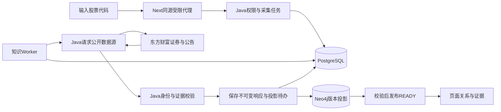

# 证券自动采集与可追溯知识图谱

更新：2026-11-11。正式工程：`<仓库根目录>`。

## 已实现的使用流程

在本机工作台打开 `/knowledge-graph`，或从右上角“研究空间”选择“知识图谱”。使用现有开发账号登录，选择有编辑权限的项目，输入 `600519` 或 `SZ:000001`，点击“获取资料并构建图谱”。无需准备文件。

系统自动获取证券身份、可选的来源行业分类及最多8条近期公告，保存采集响应、校验证券和证据，投影到Neo4j后发布可查询版本。点击关系可以查看来源页面、公开时间、抓取时间及保存的来源记录；支持下载关系与证据、下载来源快照并在浏览器校验SHA-256。

2026-11-11的真实Chrome验收：600519生成10个节点、9条关系，包含证券、来源行业与8条公告。数据不是合成样例；任务、版本与原文可在本地运行采集验收脚本后查看。

## API属于哪一层

用户提供的API为DeepSeek模型服务，不能替代行情或公告数据来源。接口连接已实测：查询模型列表200，固定短句调用200，`deepseek-flash`返回OK。当前实例可选择的模型以当次 `/models` 响应为准，不把本机观察写成永久可用承诺。

Java 直接请求东方财富，取得证券分类和公告。基础采集不用模型；正文候选抽取与审核发布见《公告正文与关系审核》。模型不能直接发布关系。

密钥仅在根目录 `.env` 的 `SIGNALFORGE_DEEPSEEK_API_KEY` 中由服务端读取。前端只取得配置状态、模型名、测试时间和用量。不要把密钥填入 `NEXT_PUBLIC_*` 变量或提交源码。修改配置后需重启Java；不需要重建或重置开发账号。

## 模块与数据流



| 模块 | 职责 |
| --- | --- |
| Java `KnowledgeSource` | 规范化沪深股票代码，读取公告与证券分类；公告源必须成功，行业缺失可继续 |
| Java `KnowledgeController` | 项目授权、请求校验、幂等键、任务/版本/来源读取及模型测试 |
| `KnowledgeSource` | 内部Bearer令牌、HTTP/1.1、27秒请求超时、1MiB响应上限 |
| `KnowledgeEvidence` | 证券一致性、公告归属、允许的来源地址、不可变响应摘要与图谱清单 |
| `KnowledgeStore` | 任务领取、租约、取消、来源版本、缓存复用与投影完成记录 |
| `KnowledgeWorker` | 采集→验收→暂存→投影→发布；外部I/O不占数据库锁事务 |
| `GraphProjection` | 项目/版本隔离的幂等写入、实际Neo4j查询与清单比对 |
| 前端 `knowledge-graph` | 采集表单、状态轮询、最近任务、关系图/列表、证据和下载 |

## 第一版关系合同

| 起点 | 关系 | 终点 | 证据能说明什么 |
| --- | --- | --- | --- |
| Security | CLASSIFIED_AS | Industry | 当前东方财富 `f100` 分类字段，保留分类体系 |
| Security | HAS_ANNOUNCEMENT | Announcement | 来源公告列表明确包含该证券代码及公告标识 |

暂不创建Company身份映射、客户/供应链、收购完成或ETF持仓关系。公告标题、正文和模型常识支持的结论不同；目录快照中的 `bodyStatus=NOT_COLLECTED` 表示采集当时状态，保持不可变。正文已通过独立文档版本抓取、解析和校验，不回写旧目录。

每条关系关联 `evidenceKey`。证据包含 `sourceUrl`、`recordPath`、`observedAt`、可空的 `publishedAt`、`snapshotHash`、证据范围及来源记录。`recordPath`标识采集响应中的定位，不代表PDF页码。未知公开时间保持空值。

## 数据、版本与一致性

Flyway V3新增三个表，仅管理Java的 `sf_` 数据：

| 表 | 职责 |
| --- | --- |
| `sf_knowledge_job` | 项目内幂等任务、状态、执行次数、租约、截止时间、执行令牌和关联快照 |
| `sf_knowledge_snapshot` | 响应text原文、原文字节摘要、内容摘要、图谱jsonb清单、PENDING/READY和来源时间 |
| `sf_knowledge_outbox` | 暂存来源时同事务记录的投影待办，成功发布时标记完成 |

状态为 `QUEUED → COLLECTING → PROJECTING → SUCCEEDED`，非终态可失败或取消。单知识Worker在短事务内领取，40秒租约、3秒心跳、180秒截止，最多3次领取。采集错误直接失败，投影失败可有限重试；恢复保留原来源版本。来源失败后修复服务，可用新幂等键重新提交。

任务在来源尚未取得时没有知识outbox。来源快照和投影待办同事务保存；当前Worker依据任务状态及租约领取，outbox记录待投影与完成状态，不是独立消息队列消费者。任务、研究outbox和知识outbox相互独立。

Neo4j使用 `SFKnowledgeNode` 节点及 `SFGraphRelease` 版本标记；节点与关系键包含项目、版本及实体/关系标识。相同版本可重复投影。PostgreSQL和Neo4j不共享本地事务：先保存PENDING来源，再写Neo4j，最后在校验状态、令牌、租约及截止时间后发布READY。取消或执行权变更阻止迟到发布；已写入但未发布的投影不开放查询，后续需增加清理任务。

图谱接口实际从Neo4j取节点与边，并与PostgreSQL保存的清单比对；不完整时返回错误。Neo4j不可用不冒充查询成功，PostgreSQL中的来源快照仍可读取。重新采集可复用已保存版本并幂等重建投影；跨数据库全量灾备重建命令尚未实现。

两种摘要分别用于不同目的：`snapshotHash`对应保存的UTF-8响应原文，可在下载后复核；`contentHash`由Java对排除抓取时间及供应商contentHash后的内容规范化计算，用于去重。相同项目、证券及内容不重复建版本。同项目同证券可复用一小时内已发布快照，保留原抓取时间，不延长TTL。

## 接口

Java基础路径：`/api/projects/{projectId}/knowledge`。经过工作台代理时为 `/api/java/projects/{projectId}/knowledge`。沿用现有session、项目授权和CSRF，OWNER可写，READER只读。

| 方法与后缀 | 行为 |
| --- | --- |
| POST `/collections` | 请求 `{"securityId":"600519"}`；必填8至128位字母数字/下划线/连字符组成的Idempotency-Key；新任务202，同键同证券200，冲突409 |
| GET `/collections` | 项目最近30条任务 |
| GET `/collections/{id}` | 状态、错误阶段、是否复用、快照ID |
| POST `/collections/{id}/cancel` | 取消非终态，已终态返回原状态 |
| GET `/releases/{id}` | READY版本的Neo4j节点、关系与证据 |
| GET `/releases/{id}/source` | 原始采集响应；授权后读取，包含未发布来源；Cache-Control为private/no-store |
| GET `/model` | 模型是否配置、最近连接测试结果与用量 |
| POST `/model/probe` | 固定短句测试，每实例每分钟最多一次，会产生少量模型用量 |

采集在 Java 知识 Worker 内执行，使用固定来源。浏览器不能提交任意网址、SQL 或 Cypher。

## 配置与本机运行

沿用当前 Java 版数据库与账号。Neo4j Java Driver 由 Maven 管理。

| 配置 | 含义 |
| --- | --- |
| `SIGNALFORGE_KNOWLEDGE_WORKER_ENABLED` | 默认true，控制知识任务派发 |
| `NEO4J_BOLT_PORT` / `NEO4J_PASSWORD` | 沿用根.env，默认本地47687、账号neo4j |
| `SIGNALFORGE_DEEPSEEK_API_KEY` | 可选；缺失时结构化采集/图谱仍可使用 |
| `SIGNALFORGE_DEEPSEEK_MODEL` | 本版默认deepseek-flash；以实际账户模型列表为准 |

基础设施已运行时，两个终端分别执行：

```powershell
# 在仓库根目录执行
.\scripts\start-backend.ps1
```

```powershell
# 在仓库根目录执行
.\scripts\start-frontend.ps1
```

打开 `http://127.0.0.1:58872/knowledge-graph`。Java 重启后重新连接研究会话即可。

## 排查与验收

- `KNOWLEDGE_SOURCE_UNAVAILABLE`：检查公告来源连通性、证券代码及响应格式。
- `KNOWLEDGE_EVIDENCE_REJECTED`：核对证券归属、公告标识、来源及响应合同。
- `GRAPH_PROJECTION_UNAVAILABLE` / `GRAPH_UNAVAILABLE`：检查Neo4j和根.env凭据；来源已经暂存时不必重新下载。
- `GRAPH_PROJECTION_INCOMPLETE`：Neo4j查询与权威清单不一致，修复服务后重新采集以重建相同版本。
- `MODEL_HTTP_*` / `MODEL_UNAVAILABLE`：检查模型配置、模型名与外网；测试失败不阻断结构化建图。

Java 和工作台运行后，可用以下脚本复现 Chrome 验收。默认不调用收费模型，`--probe-model` 会执行一次固定短句测试。

```powershell
node verification/javascript/smoke_knowledge.cjs
node verification/javascript/smoke_knowledge.cjs --probe-model
```

该脚本使用本机Google Chrome隔离会话，不读取个人浏览器配置。会创建真实采集任务并保留开发库记录；截图与报告写入 `.runtime/knowledge-verification`。

## 完成边界与下一步

本版支持沪深A股，不支持ETF/指数知识采集或简称模糊匹配。覆盖近期公告第一页，`complete=false`；当前行业观察不是历史行业数据，`pointInTimeSafe=false`。公告PDF、正文分段、DeepSeek候选、人工审核和发布已在后续V4扩展完成，详见《公告正文与关系审核》；分页补齐、增量关注池、全文检索和Agent编排仍待开发。模型连接测试本身仅证明请求可通。

已完成的正文扩展及其预算、校验、接口和验收见《公告正文与关系审核》。下一步接有界Agent与受限证据查询，再实现关注池增量刷新。
